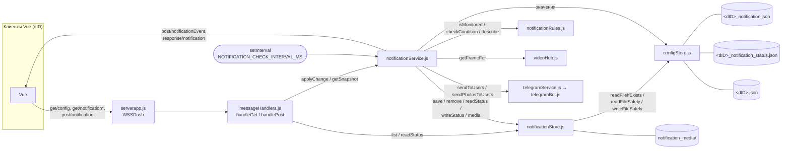
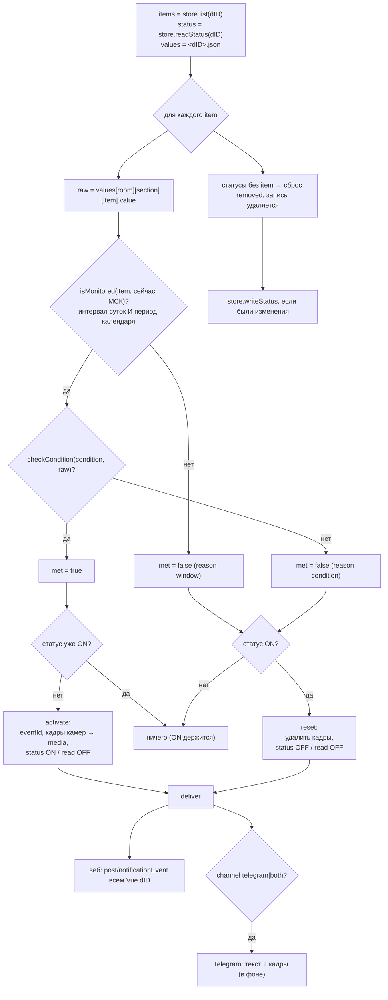
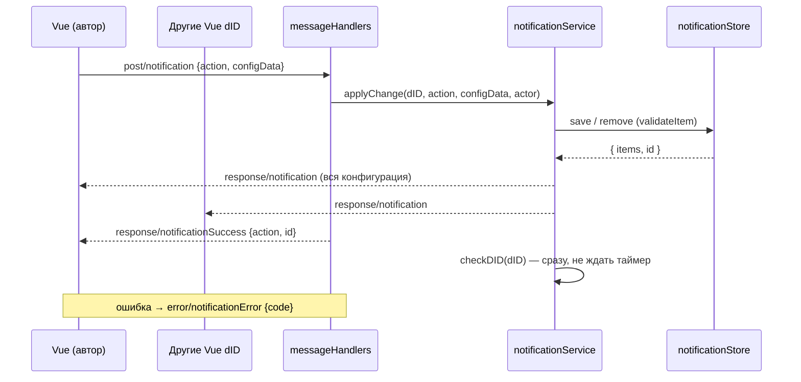
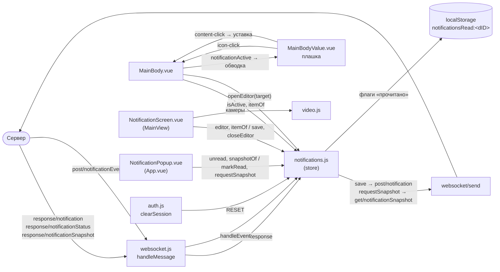
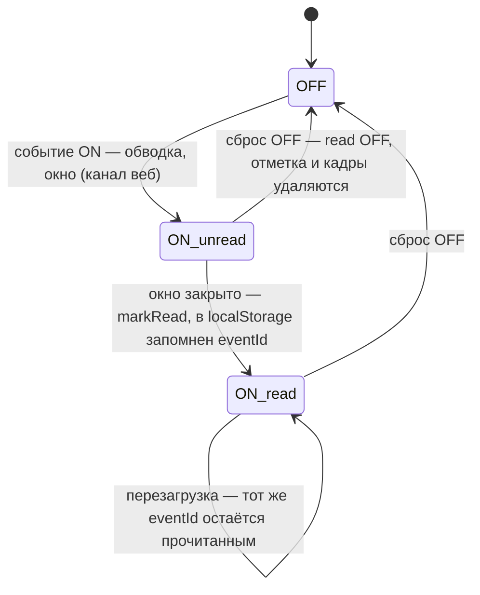
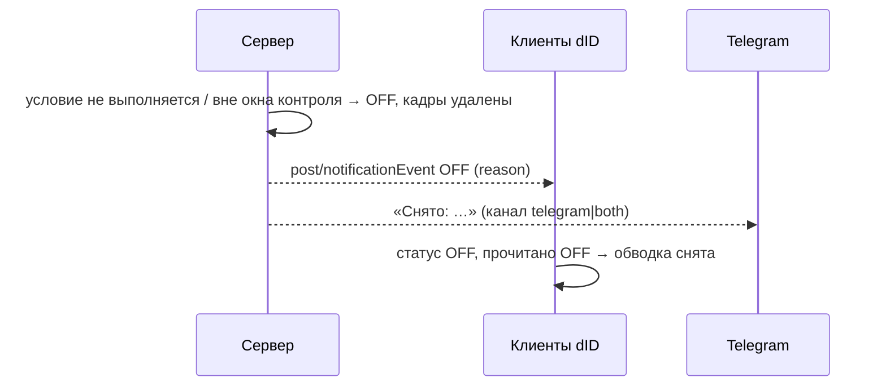

# Уведомления по условиям

Пользователь задаёт для любого параметра на экране условие (например, «температура > 25 °C»).
Сервер с заданным интервалом проверяет условия и при срабатывании создаёт **событие** (статус ON),
а когда условие перестаёт выполняться — **сброс** (статус OFF). События рассылаются всем
пользователям того же dID: в веб-приложение и/или в Telegram, с кадрами выбранных камер.

> Этот файл одинаковый в репозиториях сервера (`docs/notifications.md`) и клиента
> (`docs/notifications.md`). Меняете механизм — обновляйте обе копии.

Содержание:
1. [Термины и файлы](#1-термины-и-файлы)
2. [Как пользоваться](#2-как-пользоваться)
3. [Форматы данных](#3-форматы-данных)
4. [Протокол WebSocket](#4-протокол-websocket)
5. [Сервер: устройство кода](#5-сервер-устройство-кода)
6. [Клиент: устройство кода](#6-клиент-устройство-кода)
7. [Сквозные сценарии](#7-сквозные-сценарии)
8. [Настройки и ограничения](#8-настройки-и-ограничения)
9. [Проверка и тесты](#9-проверка-и-тесты)

---

## 1. Термины и файлы

| Термин | Что это |
|---|---|
| **Уведомление** (конфигурация) | условие для одного параметра: что сравнивать, когда контролировать, кого и как оповещать. Одно на параметр. |
| **id уведомления** | `<room>:<section>:<item>`, например `room01:sensors:dTemp01` — комната, раздел конфигурации, параметр |
| **Статус** | `ON` — условие выполняется (событие), `OFF` — нет (сброс) |
| **Флаг «прочитано»** | только на клиенте: `ON` после того, как пользователь закрыл окно уведомления. На сервере всегда `OFF` |
| **Окно контроля** | интервалы времени суток **и** периоды календаря, в которые условие проверяется |

Файлы сервера (в `DATA_DIR`, обычно `.configData`):

| Файл | Кто пишет | Содержимое |
|---|---|---|
| `<dID>_notification.json` | пользователь (через клиент) | конфигурация уведомлений `{ id: item }`. Нет файла — уведомлений не создавали |
| `<dID>_notification_status.json` | только служба уведомлений | статусы `{ id: status }` |
| `notification_media/<dID>/<eventId>_<cameraId>.jpg` | служба уведомлений | кадры камер активного уведомления; удаляются при сбросе |
| `<dID>.json` | NodeRED, Modbus, клиент | текущие значения параметров — служба берёт отсюда `[room][section][item].value` |

Пример для `dID = igumen`: `igumen_notification.json`, `igumen_notification_status.json`.

---

## 2. Как пользоваться

1. **Плашка параметра** на главном экране имеет две зоны нажатия:
   - **иконка** (слева) — экран уведомления этого параметра;
   - **название и значения** (справа) — редактирование уставки (как раньше: одиночное нажатие —
     экран уставки, двойное — настройки расписания и аналитики).
2. Экран уведомления — по образцу экрана уставки. Если уведомление уже есть — оно показано и
   правится. Если нет — переключатель **Уведомление** в положении OFF; ON открывает параметры
   (по умолчанию: условие «≠», значение — текущее значение параметра, канал «Веб»; интервалы,
   периоды и камеры не выбраны):
   - **Условие** (обязательно): `>`, `<`, `=`, `≥`, `≤`, `≠`;
   - **Значение** (обязательно): число или, у логических параметров, ON/OFF;
   - **Интервалы контроля** — время суток «с … по», несколько; через полночь — `22:00–06:00`.
     Не заданы — круглые сутки;
   - **Периоды контроля** — несколько, любого вида: **даты** «с … по», **числа месяца**,
     **дни недели**. Подходит любой. Не заданы — круглый год;
   - **Снимок с камер** — кадры выбранных камер прикладываются к событию;
   - **Канал оповещения** — Веб, Telegram, Веб + Telegram.
3. **Закрытие экрана (✕ или Esc) сохраняет**: новое — `create`, изменённое — `edit`, переключатель
   OFF у существующего — `delete`, без изменений — ничего не отправляется. Неполные данные
   (нет значения, период без выбранных дней, дата начала позже окончания) — сообщение, экран
   не закрывается.

   `delete` удаляет **условие** на сервере. Локальный статус клиента при этом не меняется:
   если уведомление было активно, обводка и флаг «прочитано» остаются, пока сервер не пришлёт
   событие сброса (`reason: 'removed'`, обычно в течение секунды) — тогда статус и «прочитано» → OFF.
   Клиент меняет статус **только** по событиям сервера.
4. Настраивать уведомления может пользователь **уровня 2 и выше**. Уровень 1 их получает и видит
   обводку, но иконка вместо экрана показывает сообщение. Если датчик ещё не присылал данных,
   экран не открывается — сообщение «Отсутствует значение параметра».
5. **Событие** (условие выполнилось в окне контроля):
   - плашка параметра получает **красную обводку** — пока статус ON, прочитано или нет;
   - если канал «Веб» или «Веб + Telegram» — **окно уведомления**: что произошло, когда, кадры
     камер. Несколько — по одному, начиная с самого свежего. Закрыть может только пользователь;
     после закрытия флаг «прочитано» = ON, показывается следующее;
   - приложение было закрыто — все непрочитанные активные уведомления показываются при открытии;
   - Telegram — текст и кадры привязанным пользователям dID (у кого Telegram не выключен).
6. **Сброс** (условие больше не выполняется, параметр вышел из окна контроля или уведомление
   удалено): статус и флаг «прочитано» → OFF, обводка снимается, кадры удаляются; в Telegram — сообщение «Снято».
   До получения сброса клиент хранит статус как есть.
7. Маленькая оранжевая точка на иконке — для параметра настроено уведомление.

---

## 3. Форматы данных

### 3.1. Уведомление (`<dID>_notification.json`, `response/notification`)

```json
{
  "room01:sensors:dTemp01": {
    "id": "room01:sensors:dTemp01",
    "group": "Гостиная",
    "room": "room01",
    "section": "sensors",
    "item": "dTemp01",
    "roomTitle": "Гостиная",
    "title": "Температура",
    "unit": "°C",
    "condition": { "op": "gt", "value": 25 },
    "intervals": [ { "from": "08:00", "to": "20:00" }, { "from": "22:00", "to": "06:00" } ],
    "periods": [
      { "type": "dates", "from": "2026-06-01", "to": "2026-08-31" },
      { "type": "monthDays", "days": [1, 15] },
      { "type": "weekDays", "days": [6, 7] }
    ],
    "cameras": ["cam01"],
    "channel": "both",
    "createdAt": "2026-11-18T09:00:00.000Z",
    "updatedAt": "2026-11-18T09:05:00.000Z",
    "updatedBy": "anna"
  }
}
```

| Поле | Значения | Описание |
|---|---|---|
| `group`, `room`, `item` | `room`: `roomNN` или `common`; `item`: имя параметра | идентификаторы группы (заголовок комнаты), комнаты и параметра |
| `section` | `sensors` \| `system` \| `setpoints` | раздел конфигурации `<dID>.json`, где лежит значение |
| `roomTitle`, `title`, `unit` | строки | подписи для текста события и Telegram |
| `condition.op` | `gt` `>`, `lt` `<`, `eq` `=`, `gte` `≥`, `lte` `≤`, `ne` `≠` | сравнение; логические значения сравниваются как 1/0 |
| `condition.value` | число или `true`/`false` | порог |
| `intervals[]` | `{ from, to }`, `HH:MM`, до 10 | время суток, границы включительно, `from > to` — через полночь; пусто — сутки |
| `periods[]` | до 10 | `dates` (с … по, включительно), `monthDays` (1–31), `weekDays` (1 — пн … 7 — вс); пусто — год |
| `cameras[]` | id камер из `cameras.json`, до 16 | кадры к событию (камера должна быть видна dID) |
| `channel` | `web` \| `telegram` \| `both` | канал оповещения |
| `createdAt`, `updatedAt`, `updatedBy` | ставит сервер | |

Время — **московское** (UTC+3), как во всей системе.

### 3.2. Статус (`<dID>_notification_status.json`, `response/notificationStatus`)

```json
{
  "room01:sensors:dTemp01": {
    "status": "ON",
    "read": "OFF",
    "eventId": "3f0c…",
    "since": "2026-11-18T09:12:00.000Z",
    "value": 26.4,
    "text": "Гостиная · Температура: 26.4 °C (условие > 25 °C)",
    "channel": "both",
    "attachments": [ { "cameraId": "cam01", "title": "Ворота", "timestamp": 1794995520000 } ]
  }
}
```

- `status` — `ON` / `OFF`; `read` на сервере всегда `OFF`;
- `eventId` — новый у каждого события ON: по нему клиент отличает «то же» событие от нового;
- `since` — когда статус стал текущим; `value` — значение в этот момент; `text` — описание;
- `attachments` — кадры (сами изображения — по запросу `get/notificationSnapshot`); при OFF — пусто.

### 3.3. Событие (`post/notificationEvent`)

```json
{ "type": "post", "request": "notificationEvent", "name": "igumen",
  "payload": {
    "id": "room01:sensors:dTemp01", "eventId": "3f0c…", "status": "ON",
    "time": "2026-11-18T09:12:00.000Z", "channel": "both",
    "group": "Гостиная", "room": "room01", "roomTitle": "Гостиная", "section": "sensors",
    "item": "dTemp01", "title": "Температура", "unit": "°C",
    "condition": { "op": "gt", "value": 25 }, "value": 26.4,
    "attachments": [ { "cameraId": "cam01", "title": "Ворота", "timestamp": 1794995520000 } ],
    "text": "Гостиная · Температура: 26.4 °C (условие > 25 °C)" } }
```

Сброс — тот же формат со `status: "OFF"` и `reason`: `condition` (условие не выполняется),
`window` (вне окна контроля), `removed` (условие удалено). На клиенте любой сброс, в том числе
`removed`, переводит статус и «прочитано» в OFF.

---

## 4. Протокол WebSocket

Формат сообщений — общий для системы: `{ type, request, name: dID, payload }`.

| Направление | Сообщение | payload | Уровень |
|---|---|---|---|
| Vue → сервер | `get/config` | `{}` | 1 |
| сервер → Vue | `response/config`, затем `response/notification`, `response/notificationStatus` | конфигурация, уведомления, статусы — **только если файлы есть** | |
| Vue → сервер | `get/notification`, `get/notificationStatus` | `{}` | 1 |
| Vue → сервер | `post/notification` | `{ action: 'create' \| 'edit' \| 'delete', configData }` | **2** |
| сервер → все Vue dID | `response/notification` | вся конфигурация уведомлений (после каждой правки, включая автора) | |
| сервер → автор | `response/notificationSuccess` | `{ action, id }` | |
| сервер → автор | `error/notificationError` | `{ message, code, action }`; `code`: `BAD_NOTIFICATION`, `LIMIT`, `NOT_FOUND`, `BAD_ACTION` | |
| сервер → все Vue dID | `post/notificationEvent` | событие или сброс (3.3) | |
| Vue → сервер | `get/notificationSnapshot` | `{ id, cameraId }` | 1 |
| сервер → Vue | `response/notificationSnapshot` | `{ id, cameraId, title, image (base64 JPEG), mimeType, timestamp }` | |
| сервер → Vue | `error/notificationSnapshotError` | `{ code: 'NO_SNAPSHOT', id, cameraId }` — клиент не показывает | |

- `configData` для `create`/`edit` — поля 3.1 без `id`, `createdAt`, `updatedAt`, `updatedBy`
  (их ставит сервер). Повторный `create` того же параметра — правка. Для `delete` — `{ room, section, item }` или `{ id }`.
- `post/notification` **не пересылается** другим клиентам как есть (`NO_BROADCAST_POST`): сервер
  после записи сам рассылает итоговую конфигурацию.
- `notificationEvent` получают **все** соединения пользователей dID независимо от канала:
  статус нужен для обводки плашки. Канал решает, показывать ли окно (веб) и слать ли в Telegram.

---

## 5. Сервер: устройство кода

### 5.1. Модули

| Файл | Что делает |
|---|---|
| `services/notificationRules.js` | чистые функции: `normalizeValue`, `checkCondition`, `mskParts`, `inIntervals`, `inPeriods`, `isMonitored`, `describe` |
| `services/notificationStore.js` | файлы: `list`, `save` (create/edit, проверка Joi `validateItem`), `remove`, `readStatus`, `writeStatus`, кадры `saveMedia`/`readMedia`/`removeMedia`, `listDIDs` |
| `services/notificationService.js` | служба: таймер, `checkDID` (активация/сброс), доставка в веб и Telegram, `applyChange` (правки клиента), `getSnapshot` |
| `services/configStore.js` | типы `notification`, `notification_status`; `readFileIfExists` — чтение без создания |
| `services/messageHandlers.js` | `get/config` (+ уведомления), `get/notification*`, `post/notification` |
| `services/authConfig.js` | уровни (`REQUIRED_LEVEL`), `NO_BROADCAST_POST` |
| `services/videoHub.js` | `getFrameFor(dID, cameraId)` — последний кадр камеры, видимой dID |
| `services/telegramService.js`, `classes/telegramBot.js` | `sendToUsers` (текст), `sendPhotosToUsers` / `sendPhoto` (кадры, multipart) |
| `services/notifyConfig.js` | `NOTIFICATION_*` из `conf.env` |
| `serverapp.js` | запуск службы при `NOTIFICATION_ENABLED`, остановка при завершении |

### 5.2. Связи модулей



### 5.3. Проверка одного dID (`checkDID` → `evaluate`)



- Проверки одного dID выполняются **по очереди** (цепочка промисов в `checkDID`): таймер и правка
  пользователя не пересекаются. Обход всех dID пропускается, если предыдущий ещё идёт.
- Нет значения параметра (датчик не присылал данных) — условие не выполнено.
- Telegram отправляется в фоне: медленный Bot API не задерживает проверку.

### 5.4. Правка из клиента (`post/notification`)



---

## 6. Клиент: устройство кода

### 6.1. Модули

| Файл | Что делает |
|---|---|
| `store/modules/notifications.js` | состояние: `items`, `statuses`, `editor`, `snapshots`; действия `handleResponse`, `handleEvent`, `markRead`, `save`, `requestSnapshot`, `openEditor`/`closeEditor`; геттеры `isActive`, `itemOf`, `unread` (очередь окна) |
| `store/modules/websocket.js` | маршрутизация: `response` → `video` → `notifications` → `config`; `post/notificationEvent` → `notifications/handleEvent` |
| `store/modules/auth.js` | при выходе `notifications/RESET` |
| `store/modules/config.js` | `handleServerError`: `notificationError` — сообщение и перезапрос `config` (с ним придут уведомления); `notificationSnapshotError` — молча |
| `components/MainBodyValue.vue` | плашка: `icon-click` (иконка), `content-click` (название/значения), `.has-notification` (обводка), метка настроенного уведомления |
| `components/MainBody.vue` | `openNotification(item)` (уровень ≥ 2 и есть значение параметра → `notifications/openEditor`), передача статуса в плашку |
| `components/NotificationScreen.vue` | экран настройки (в `MainView`, рендерится в `<body>`); при закрытии — `notifications/save` |
| `components/NotificationPopup.vue` | окно уведомлений (в `App.vue`): `unread[0]`, кадры, «Закрыть» → `markRead` |
| `assets/mainStyle.css` | `.has-notification`, `.sensor-notify-mark`, разделы 6.1 (экран) и 6.2 (окно) |

### 6.2. Связи модулей



### 6.3. Статус и флаг «прочитано» на клиенте



- Сервер хранит `read: 'OFF'` всегда. Клиент при получении `notificationStatus` ставит `read: 'ON'`,
  если в `localStorage` (`notificationsRead:<dID>`) для этого id записан **тот же** `eventId`.
  Новое событие (другой `eventId`) снова непрочитано.
- Очередь окна (`unread`): статус ON, `read` OFF, канал `web`/`both`; сортировка по `since`,
  свежие первыми.
- Окно не закрывается само и по таймеру — только пользователем.

---

## 7. Сквозные сценарии

### 7.1. Создание и срабатывание

```mermaid
sequenceDiagram
  actor U as Пользователь (уровень 2)
  participant C as Клиент
  participant S as Сервер
  participant D as Другие клиенты dID
  participant TG as Telegram
  U->>C: нажатие на иконку плашки
  C->>C: NotificationScreen: ON, условие, окна, камеры, канал
  U->>C: ✕ (закрыть)
  C->>S: post/notification {action: create, configData}
  S->>S: <dID>_notification.json
  S-->>C: response/notification + notificationSuccess
  S-->>D: response/notification
  Note over S: раз в NOTIFICATION_CHECK_INTERVAL_MS
  S->>S: значение > порога, в окне контроля → ON, кадры камер
  S-->>C: post/notificationEvent ON
  S-->>D: post/notificationEvent ON
  S-->>TG: текст + кадры (канал telegram|both)
  C->>C: красная обводка; окно уведомления (канал web|both)
  C->>S: get/notificationSnapshot (кадры для окна)
  S-->>C: response/notificationSnapshot
  U->>C: «Закрыть» → прочитано ON (обводка остаётся)
```

### 7.2. Сброс



### 7.3. Приложение было закрыто

```mermaid
sequenceDiagram
  participant C as Клиент (открыт позже)
  participant S as Сервер
  C->>S: get/config
  S-->>C: response/config
  S-->>C: response/notification
  S-->>C: response/notificationStatus (ON, read OFF)
  C->>C: read из localStorage (тот же eventId → прочитано)
  C->>C: обводка у активных; окно — непрочитанные, свежие первыми
```

---

## 8. Настройки и ограничения

`conf.env` сервера:

| Параметр | По умолчанию | Описание |
|---|---|---|
| `NOTIFICATION_ENABLED` | `true` | `false` — служба не запускается (конфигурацию можно править, событий нет) |
| `NOTIFICATION_CHECK_INTERVAL_MS` | `10000` | интервал проверки условий, не меньше 1000 |
| `NOTIFICATION_MAX_ITEMS` | `200` | уведомлений на один dID |
| `NOTIFICATION_MEDIA_DIR` | `$DATA_DIR/notification_media` | каталог кадров активных уведомлений |

Telegram — общие настройки `TELEGRAM_*` (бот, привязка пользователей) — см. `conf_example`.

Ограничения:
- **Задержка.** Значения датчиков попадают в `<dID>.json` через очередь `messageStore` раз в 15 с,
  поэтому событие отстаёт от показания до 15 с + `NOTIFICATION_CHECK_INTERVAL_MS`.
- **Без гистерезиса.** Значение, колеблющееся у порога, может давать события и сбросы на каждой
  проверке. Порог лучше ставить с запасом.
- **Одно уведомление на параметр.** Повторный `create` того же параметра — правка.
- **Кадр камеры** — последний кадр, который сервер получил от камеры (раз в `previewIntervalMs`/
  `fullIntervalMs`); камера без кадров к событию не прикладывается.
- **Telegram** получают пользователи dID с привязанным чатом, у которых в профиле Telegram не выключен
  (`notify.telegram !== false`). Порог важности (`minSeverity`) для этих уведомлений не применяется.

---

## 9. Проверка и тесты

Сервер (`npm test`):
- `tests/unit/notificationRules.test.js` — условия, окно контроля (МСК, через полночь, периоды), тексты;
- `tests/unit/notificationStore.test.js` — проверка данных, файлы, кадры, обход dID (на временных файлах);
- `tests/unit/notificationService.test.js` — ON/OFF, окно, каналы, кадры, правки, таймер;
- `tests/unit/messageHandlers.test.js` («уведомления»), `telegramBot.test.js` (`sendPhoto`),
  `telegramService.test.js` (`sendPhotosToUsers`).

Клиент (`pnpm test`):
- `notifications.spec.js` — ответы сервера, события, флаг «прочитано», очередь, запросы;
- `NotificationScreen.spec.js` — create / edit / delete, логические параметры, проверка данных;
- `NotificationPopup.spec.js` — очередь окна, закрытие, кадры;
- `MainBodyValue.spec.js` — две зоны нажатия, обводка, метка; `MainBodyNotification.spec.js` — уровень доступа.

Ручная проверка без датчиков — эмулятор Modbus TCP (`docs/modbus-tcp.md`, раздел 6):

1. Запустите эмулятор и сервер с `MODBUS_DEVICES` на эмулятор; для наглядности
   `NOTIFICATION_CHECK_INTERVAL_MS=2000`.
2. В клиенте (уровень 2) нажмите иконку плашки температуры, включите уведомление «> 25», канал «Веб», закройте экран.
3. В эмуляторе: `set dTemp01 30` — через 15–20 с появятся красная обводка и окно уведомления.
4. `set dTemp01 20` — обводка снимается (сброс).
